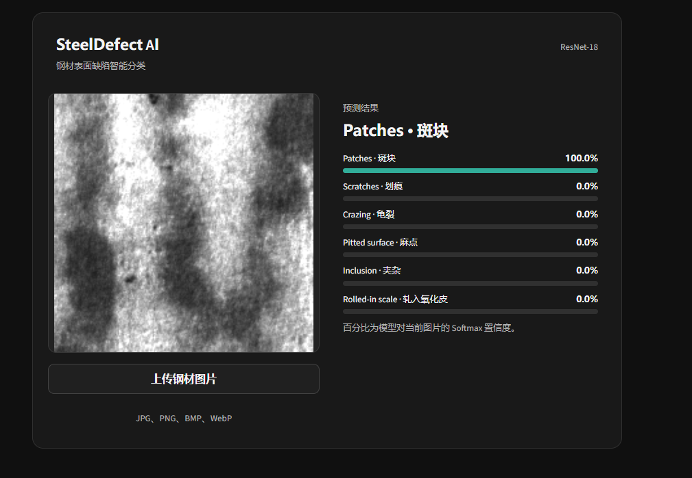

# SteelDefect AI · 钢材表面缺陷分类

基于 PyTorch 和 NEU-CLS 数据集，对热轧钢带表面图像进行六类缺陷分类。项目比较了普通 CNN、完整 ResNet-18 和两种末级残差阶段的简化结构，并提供 Gradio 网页用于上传图片和查看预测结果。完整 ResNet 在同一测试集上的准确率为 **97.78%**，相较普通CNN 准确率提高 **10.00%**。

## 数据集与训练设置

数据集来自东北大学发布的 NEU-CLS ，包含 1,800 张 200 × 200 的灰度图像，每类 300 张。项目使用其中 1440 张训练（每类 240 张），360 张测试（每类 60 张）。[NEU 钢材表面缺陷数据集](https://faculty.neu.edu.cn/songkc/en/zdylm/263265/)

| 目录名 | 英文类别 | 中文类别 |
| --- | --- | --- |
| `Cr` | Crazing | 龟裂 |
| `In` | Inclusion | 夹杂 |
| `PS` | Pitted surface | 麻点 |
| `Pa` | Patches | 斑块 |
| `RS` | Rolled-in scale | 轧入氧化皮 |
| `Sc` | Scratches | 划痕 |

- 输入统一转换为单通道灰度图，缩放至 200 × 200 后转为张量。
- 各模型训练 50 轮，批大小为 32，使用 Adam 优化器和交叉熵损失。模型学习率均为 `0.001`。
- 脚本会保存最佳训练准确率权重，再加载该权重计算测试准确率。当前脚本未设置独立验证集或固定随机种子。

## 项目结构

```text
.
├── CNN/
│   └── CNN.py                     # CNN 基线训练与测试
├── ResNet/
│   ├── ResNet.py                  # 完整 ResNet 训练与测试
│   ├── ResNet_best_acc.pth        # Gradio 使用的完整模型权重
│   ├── ResNet-b5-1/
│   │   └── ResNet-b5-1.py         # b5 减为一个残差块
│   ├── ResNet-b5/
│   │   └── ResNet-b5.py           # 移除 b5
│   └── demo/                     # Gradio 页面、推理代码和依赖清单
├── NEU-CLS/                      # 训练图片，按类别分目录
├── Testset/                      # 测试图片，按类别分目录
├── fenlei.py                     # 按 BMP 文件名前缀整理类别目录
└── test.py                       # 查看 PyTorch 与 CUDA 环境
```

## 实验结果

四个模型均使用RTX3060 Laptop训练，训练时间来自本次实验记录，具体耗时随硬件和运行环境变化。表中的准确率差值按脚本记录计算后四舍五入。`b5` 是完整 ResNet 的最后一个残差阶段，由两个残差块组成，输出 512 通道：

```b5=nn.Sequential(*RESBmaker(256,512,2))```

| 模型 | 网络结构 | 测试准确率 | 相对完整 ResNet | 训练时间记录 |
| --- | --- | ---: | ---: | --- |
| CNN | 两层卷积的基线模型 | 87.78% | −10.00% | 1min56s |
| ResNet | 完整 `b5`，含两个残差块 | **97.78%** | 标准 | 10min32s |
| ResNet-b5-1 | `b5` 仅保留一个残差块 | 60.00% | −37.78% | 9min40s |
| ResNet-b5 | 移除 `b5`，分类头直接接收 `b4` 的 256 通道输出 | 91.94% | −5.83% | 8min25s |

在本次实验中，使用经典ResNet-18模型测试准确率可以达到接近**98%**。

仅保留b5一个残差块进行实验，模型训练准确率超过 **96%**，测试准确率约为 **60%**，训练与测试表现差距较大，出现显著的过拟合现象。而相较于完整ResNet训练时间仅缩短**8%**。

移除整个 `b5` 进行实验，模型测试准确率约为**92%**，相较完整ResNet训练时间缩短**20%**。
## Gradio Demo运行及演示

在仓库根目录打开 PowerShell，依次执行以下命令。Demo 使用完整 ResNet 的权重，启动前请将 `ResNet_best_acc.pth` 放在 `ResNet/` 下。

```powershell
python -m venv .venv
.\.venv\Scripts\python.exe -m pip install -r ResNet/demo/requirements.txt
.\.venv\Scripts\python.exe ResNet/demo/app.py
```

打开终端显示的本地地址（通常为 `http://127.0.0.1:7860`），上传一张 JPG、PNG、BMP 或 WebP 图片。页面会显示预测类别，并按各类别可能概率从高到低列出六类结果。推理在 CUDA 可用时使用 GPU，否则使用 CPU。demo展示如图：



## 重新训练

1. 将训练图像和测试图像分别放到 `NEU-CLS/` 和 `Testset/`，并在两者下建立所列的六个类别目录。比较模型时沿用同一批测试图片。
2. 将训练脚本中两个 `datasets.ImageFolder` 的 `root` 改为本机的训练和测试图片路径。把 `torch.load` 中的绝对路径改成同一脚本里 `torch.save` 使用的权重文件名，使保存和读取都指向运行目录。
3. 进入对应的模型目录再运行脚本。以下命令从仓库根目录启动完整 ResNet 的 50 轮训练，使用 Demo 步骤创建的虚拟环境。

   ```powershell
   Set-Location ResNet
   ..\.venv\Scripts\python.exe ResNet.py
   ```

   训练完成后，终端会输出测试准确率，生成的 `ResNet_best_acc.pth` 可直接用于 Demo。
